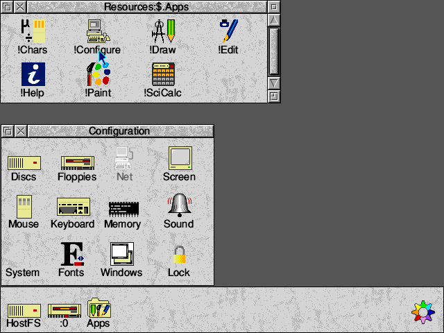
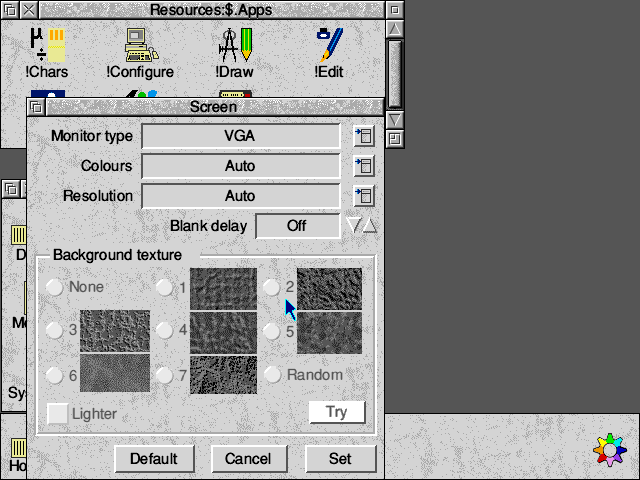

<p align="center"></p>

<h1 align="center">ROO311</h1>

<p align="center"><b>RISC OS Open for the Archimedes, compatible with RISC OS 3.11.</b><br>A free ROM image built from the RISC OS Open sources with open tools, which can take the place of the commercial RISC OS 3.11 ROM in an Archimedes emulator.</p>

<p align="center"><a href="../../releases/latest"><b>Download the ROM image</b></a></p>

<p align="center">Discord: <a href="https://discord.gg/88VzuWSYUc">https://discord.gg/88VzuWSYUc</a></p>



## What it does

ROO311 is a port of RISC OS Open to the 26-bit Acorn Archimedes. It looks and works like RISC OS Open, and it's built to be compatible with RISC OS 3.11, so the aim is for it to run what RISC OS 3.11 ran.

An Archimedes emulator needs a RISC OS ROM image before it can start, and the RISC OS 3.11 one is commercial. ROO311 is a free and open ROM image that an emulator can load where it would load that one, so an emulated A5000 starts in the desktop with no commercial ROM and no hard disc. It boots a game from its floppy image, and it has Chars, Help, Edit, Draw, Paint, SciCalc and Configure in the ROM.

The whole ROM is one 2MB file. It's unfinished, see [What works](#what-works).

## Why

I have been creating a number of tools to allow the easy launching of some of my, and my kids' favourite games on the Raspberry Pi, such as [Knytt](https://github.com/jameshansen/PiKnytt) and [Klass of 99](https://github.com/jameshansen/PiKlassOf99), and I have been sharing these projects here for other fans of these lesser known titles. I wanted to add the Risc OS version of Lemmings, along with other games freely released on [JASPP](https://forums.jaspp.org.uk/forum/index.php) to that list. The problem is that these old games require a commercial Risc OS 3.11 ROM, so the ultimate purpose of this project to eliminate that block to releasing a future tool to do this onto GitHub.

As such, the goal of this project is four-fold:
* Support all of the JASPP game releases that supported Risc OS 3.11 out of the box. See [JASPP games](#jaspp-games) for where this stands.
* Retain the look and feel of RISC OS Open, rather than 3.11.
* Consider quality of life improvements and other modernizations to be added to the ROM.
* Tweak ROM to improve integration with any future tools I release if needed.

I also want to give a quick shout out to a similar project called [arclibre](https://github.com/acorn-playground/arclibre/) by James Randall.

## The original ROM

RISC OS 3.11 is the last version of RISC OS that Acorn released for the Archimedes, and its ROM image is commercial. [RISC OS Open](https://www.riscosopen.org) publishes the sources of later versions, the oldest of which is RISC OS 3.60 from 1995.

ROO311 is built from those sources. The kernel and most modules are RISC OS 3.60's, which was the last version to carry the code for the Archimedes's MEMC1 memory controller, and a few parts come from the current sources. Every file in the ROM comes from the RISC OS Open repositories or was written for this project, and nothing is copied from a commercial ROM.

ROO311 is an unofficial project and isn't affiliated with RISC OS Open Ltd.

## How the commercial ROMs were used

The commercial ROMs were available throughout development, and this section sets out exactly how they were used. No code or data in ROO311 is copied from them. Some facts about RISC OS 3.11 were taken from its ROM, and ROO311 was tested against that ROM. The lists below cover everything ROO311 takes from the commercial ROMs and every fault they helped find, ordered from observing the ROM as it runs to disassembling its code.

The ROMs helped find 8 faults. Of those, 4 were real faults in the published source, all in code for these older machines that nothing had built since RISC OS 3.5. Another 2 only showed in MAME, where the published source does something MAME's A5000 doesn't accept. The other 2 were caused by this project's own build tools and setup.

### Watching RISC OS 3.11 run in the emulator

Nothing in this group looks inside the ROM. It's what anyone can see by using a RISC OS 3.11 machine.

- **The settings a CMOS reset gives.** The CMOS was reset under 3.11 (Delete held at power on) and the settings were read back. From that, ROO311's reset table for these machines sets drive 0, NoBoot and mouse step 3, and leaves out the Risc PC's later settings. The source's own comments record that Boot and drive 4 replaced NoBoot and drive 0 in September 1993, so mouse step 3 is the only value that depends on the readback.
- **Testing.** The same games, commands and CMOS resets were run on both ROMs and the screens were compared, in Arculator and then in ArcEm and MAME. That's how [What works](#what-works) was checked, and the memory figures there were read from each ROM's Task Manager. Where ROO311 misbehaved, the same run on 3.11 showed the correct behaviour.
- **The 2 faults that stopped ROO311 in MAME.** RISC OS 3.11 started in the desktop in MAME's A5000 and ROO311 stopped before it, which showed the faults were ROO311's and not the emulator's. Both were then found with MAME's debugger, from ROO311's source and MAME's, and nothing in the 3.11 ROM was read for either. The kernel dropped the I2C clock and data lines in one write after an acknowledge, which MAME's model of the clock chip reads as a new start, so the CMOS RAM couldn't be read. ADFS sent the floppy controller the command that turns on its FIFO, which the source added for the Risc PC's controller, and when MAME's controller refused it the error path jumped to address 0.

### Reading names and text out of the ROM file

This group reads the ROM image as data, and no code is disassembled. The same information is shown by `*ROMModules` and `*Help` on a real machine, or is visible on its screen.

- **The module list and its order.** A script read the list of modules from the 3.11 ROM image. `Sources/MODULES` builds 70 of those modules in the same order, except Squash, and the list determined which components were imported. The list is also public, and a [listing of `*ROMModules` on 3.11](https://www.chiark.greenend.org.uk/~theom/riscos/mods/311.html) gives the same order.
- **The date in DOSFS's help string.** The header tool stamps the build date into this string, which made every build different. The string was given a fixed date instead, 01 Mar 1995, which is the date DOSFS 0.62 carries in the 3.60 ROM. Any fixed date would have worked. This is one of the 2 faults caused by the build setup.
- **The teletext font.** One character was missing from ROO311's font, and comparing its font table with 3.11's showed which one. The cause was the assembler, AsAsm, which treats a comment ending in a backslash as continuing on the next line, so one line of the font was lost. The font data itself comes from the source. This is the other fault caused by the build tools.

### Disassembling code

These are the cases where the ROM's code was read. In each case the fix was written for ROO311, and a comment in the source notes that the ROM was consulted.

- **The first word of the ROM** (3.11, `&03800000`). Some games reset the machine by copying this word to address 0 and jumping to it. With the word the later source produces, the machine was only partly reset. The word in the 3.11 ROM was read and found to be a branch that still works from address 0. ROO311 now has a branch of the same kind, calculated from its own reset address. This was a real fault, because the later source had changed how a reset is entered.
- **`*ScreenLoad`'s palette** (3.11, `&0381C4C0`). A 256 colour picture loaded with a black palette. The routine in 3.11 takes the sprite pointer from R2. ROO311's routine read it from a register that is never set on a kernel without mode selectors. The fix uses R2, and the fault can be seen from the source alone. This was a real fault.
- **Changing a dynamic area's size** (3.11, `&0380AAC0`). The kernel reported CAM Map Corrupt at start-up. Comparing its code with 3.11's showed that a branch had ended up inside the wrong conditional case, so a MEMC1 build returned to a stale address. The branch was moved back to the correct place. This was a real fault.
- **The Podule manager's loop over extension ROMs.** The machine hung at start-up with an extension ROM fitted. 3.11's Podule module was disassembled to compare, and it has no such loop. The loop in ROO311 kept its count in a register that the routines it calls overwrite, and the fix is new code. This was a real fault, in code that the Risc PC builds had switched off.
- **Where the VDU variables are.** Comparing the kernel's code with 3.11's showed that some VDU variables are at different addresses, which is recorded under [How it works](#how-it-works).

## Features

- **A drop-in ROM image.** It's one 2MB file, the size an A5000 and Arculator take, so it goes in place of the RISC OS 3.11 one.
- **Open from end to end.** The sources are RISC OS Open's, the assembler is AsAsm and the C compiler is GCC, so nothing proprietary is needed to build it.
- **The RISC OS Open look.** It has 3D windows, Homerton as the desktop font, textured backgrounds, high resolution icons, the multi-coloured cog on the icon bar and the RISC OS Open start-up banner.
- **Applications in the ROM.** Chars, Help, Edit, Draw, Paint, SciCalc and Configure run straight from the Apps folder.
- **No hard disc needed.** The machine starts in the desktop from the ROM alone, and holding Shift as it starts boots the floppy disc in drive 0, which is how Blaston (1991) starts from its floppy image.
- **Old programs run.** The SharedCLibrary is in the ROM with RISC_OSLib inside it, the way RISC OS 3 had it, and Battle Chess (1992), a C game built with the Norcroft compiler, runs on it.
- **RISC OS 3.11's settings.** A CMOS reset gives RISC OS 3.11's defaults, Configure keeps the monitor type and the desktop's mode in the CMOS RAM, and its Screen window changes the screen straight away.
- **Fits in 2MB.** The message files are tokenized and the BASIC applications crunched and squished, the same way the original build did it, which leaves 3K spare.



## What works

The ROM is tested in Arculator on an A5000-style machine (ARM3, MEMC1a, 82C711, 4MB), driven by a script. It has also been started in ArcEm 1.50.2 and in MAME 0.285's A5000, and in Arculator with less memory.

### Works

- Kernel on MEMC1/IOC/VIDC1, 26-bit throughout
- 70 ROM modules initialize
- Configure runs from the Apps folder. Its Screen window sets the monitor type and the desktop's mode, and the screen changes at once and comes back the same after a reset
- Supervisor prompt, keyboard, mouse, `*` commands
- The mouse pointer in every desktop mode tried (0, 12, 13, 15, 20, 21, 27, 28 and 31), with its double-click shape, the hourglass and `*Pointer`
- Starts in the desktop with 512K, 1MB, 2MB and 4MB of RAM, see [Memory](#memory)
- ArcEm starts in the desktop too, and the pointer and menus work there
- BBC BASIC V 1.14 with graphics, FPEmulator 4.39
- Desktop with the RISC OS Open look
- Filer operations through Filer_Action (delete and count tried)
- Chars, Help, Edit, Draw, Paint and SciCalc run from the Apps folder
- Outline fonts (Font Manager and ROM fonts), scaled sprites (SpriteExtend), Squash
- ADFS floppy access on the 82C711, including `ADFS_DiscOp` writes
- HostFS from Arculator's support ROM (extension ROM loading)
- RISC OS 3.11's CMOS defaults
- 105 of the 127 JASPP games that ran on RISC OS 3.11 start the same way, with no ADFFS, see [JASPP games](#jaspp-games)
- SharedCLibrary 4.79 with RISC_OSLib inside it, the C parts compiled with GCC. A test program passes every check
- Battle Chess (1992) runs on that library

### Not yet

- DOSFS is in the ROM but hasn't read a DOS disc yet
- Alarm (its machine code helper is assembled by a BASIC program, and the image has no room left for it)
- Configure's settings that live in a boot application on disc, which are the desktop font, the RAM disc and the background texture
- Palette utility on the icon bar
- Printing modules, Econet and NetFS
- Power-on self test
- Hard disc access is untested
- Sound hasn't been listened to
- 4 JASPP games that run on RISC OS 3.11 don't run yet, see [JASPP games](#jaspp-games)
- MAME's A5000 gets as far as the desktop and stops while drawing the start-up banner. The banner's sprites unpack wrongly there, and the cause hasn't been found. The keyboard and mouse are untried in MAME
- Red Squirrel shows no mouse pointer
- ArcEm's hard disc, an ST506 drive, gets no icon, and ADFS says the drive isn't known
- Real hardware is untried

### Memory

ROO311 starts in the desktop with 512K of RAM or more. The table shows what's left for applications once the desktop is up in a 640 by 480 mode with 16 colours, which is Next plus Free in the Task Manager, beside the same figure for RISC OS 3.11.

| RAM | ROO311 | RISC OS 3.11 |
| --- | --- | --- |
| 4MB | 3584K | 3648K |
| 2MB | 1568K | 1632K |
| 1MB | 568K | 632K |
| 512K | 56K | 128K |

ROO311 leaves about 64K less at every size. 1MB is the least it's usable with, since the 56K left on a 512K machine runs almost nothing.

The image uses 2,093,664 of the 2MB (2,097,152 bytes), and A5000 hardware and Arculator both stop at 2MB.

## JASPP games

[JASPP](https://www.jaspp.org.uk), the Archimedes Software Preservation Project, releases Archimedes games with their publishers' permission, and its release page for each game on the [JASPP forum](https://forums.jaspp.org.uk/forum/index.php) lists the versions of RISC OS the original release ran on. 127 of the releases ran on RISC OS 3.11, and each one was started on ROO311 and on RISC OS 3.11 to compare them. 105 reach the same screen on both ROMs, 4 don't run on ROO311 yet and 18 couldn't be judged.

Each game's first floppy went in drive 0 of an emulated ARM3 machine with 4MB and no ADFFS. The 800K discs used the 1772 floppy controller of the A3000 and A400 series, and the 1.6MB discs used the A5000's 82C711. A disc that boots was booted with Shift held at power on, and any other was opened in the desktop and its game run, as a double-click would. Screens from 35 seconds to 2.5 minutes in were then compared with RISC OS 3.11's. Reaching a title screen, a demo or a request for the next disc counts as starting, and none of the games were played through. The floppy images are JASPP's own, turned into plain sector images or, for copy-protected discs, bit-level HFE images.

- 🟢 Reaches the same screen as on RISC OS 3.11
- 🟡 Starts, with a difference
- 🔴 Runs on RISC OS 3.11 but not on ROO311
- ⚪ Not judged, since it has no floppy image, has to be installed to a hard disc first, or doesn't start on RISC OS 3.11 in this test either

The Starts column says how each game started on RISC OS 3.11. A full screen game takes over the screen as soon as it starts, and a desktop game opens in a window. Some put an icon on the icon bar first and start when it's clicked. Not seen means the test didn't get far enough to tell.

| | Game | Year | Starts | Notes |
| --- | --- | --- | --- | --- |
| 🟢 | Acheton and Kingdom of Hamil | 1987 | Full screen |  |
| ⚪ | Alone In the Dark | 1995 | Not seen | Has to be installed to a hard disc first |
| 🟢 | Apocalypse | 1990 | Full screen |  |
| 🟢 | Avon and Murdac | 1989 | Full screen |  |
| ⚪ | Ballarena | 1990 | Not seen | Doesn't start on RISC OS 3.11 in this test either |
| 🟢 | Battle Chess | 1993 | Full screen | Asks to confirm its original disc on both ROMs |
| 🟢 | Battle Tank | 1990 | Full screen |  |
| 🟢 | Black Angel [16-02-1993] | 1993 | Not seen |  |
| 🟢 | Blaston | 1991 | Full screen |  |
| 🟢 | Bobby Blockhead vs The Dark Planet | 1991 | Full screen |  |
| ⚪ | Botkiller | 1995 | Not seen | No floppy image to boot |
| 🟢 | Botkiller2 | 1999 | Full screen |  |
| 🟢 | Break 147 & Superpool | 1991 | Full screen |  |
| ⚪ | Bubble Fair | 1991 | Not seen | Doesn't start on RISC OS 3.11 in this test either |
| 🟢 | Bug Hunter & Moondash | 1990 | Full screen |  |
| 🟢 | Bug Hunter in Space | 1990 | Full screen |  |
| 🟢 | Cannon Fodder | 1994 | Full screen |  |
| 🟢 | Carnage Inc | 1993 | Full screen |  |
| ⚪ | Cartoon Line part one | 1991 | Not seen | Doesn't start on RISC OS 3.11 in this test either |
| 🟢 | Cascade | 1992 | Full screen |  |
| 🟢 | Casino | 1989 | Not seen |  |
| 🟢 | Caverns | 1991 | Full screen |  |
| 🟢 | Chequered Flag [RO3 version] | 1992 | Full screen |  |
| 🟢 | Chocks Away Compendium [Mark 2 version] | 1991 | Full screen |  |
| 🟢 | Chuck Rock | 1991 | Full screen |  |
| 🟢 | The Cobalt Seed | 1995 | Full screen |  |
| ⚪ | Command Ship | 1995 | Not seen | Doesn't get past its disc check on RISC OS 3.11 in this test either |
| 🟢 | Crisis | 1990 | Full screen |  |
| 🟢 | Cyber Ape | 1995 | Full screen |  |
| 🟢 | Cycloids | 1993 | Full screen |  |
| 🟢 | Drifter | 1997 | Full screen |  |
| ⚪ | Drifter [SA version] | 2000 | Not seen | Has to be installed to a hard disc first |
| 🟢 | Drop Ship | 1990 | Full screen |  |
| ⚪ | Dune II - Battle for Arrakis [CD version] | 1997 | Not seen | No floppy image to boot |
| 🟢 | E-Type | 1989 | Full screen |  |
| 🟢 | E-Type Compendium | 1991 | Full screen |  |
| ⚪ | E-Type II | 1994 | Not seen | Doesn't get past loading on RISC OS 3.11 in this test |
| 🟢 | Empire Soccer 94 | 1995 | Full screen |  |
| 🟢 | Enter The Realm | 1991 | Full screen |  |
| ⚪ | Exodus [32bit version] | 2018 | Not seen | No floppy image to boot |
| 🟢 | The Exotic Adventures of Sylvia Layne | 1993 | Full screen |  |
| 🟢 | F.R.E.D. | 1993 | Full screen |  |
| ⚪ | Fine Racer | 1991 | Not seen | Doesn't start on RISC OS 3.11 in this test either |
| 🟢 | Fire & Ice | 1995 | Full screen |  |
| 🟢 | Fireball II | 1990 | Full screen |  |
| ⚪ | Formula Two Thousand | 1994 | Not seen | Doesn't get past its disc check on RISC OS 3.11 in this test either |
| 🟢 | Freddy's Folly | 1988 | Full screen |  |
| 🟢 | Giant Killer | 1990 | Full screen |  |
| 🟢 | Gods | 1992 | Full screen |  |
| 🔴 | Grievous Bodily 'ARM | 1992 | Full screen | Shows its title, but an abort on data transfer has stopped it behind the title |
| 🟢 | Haunted House | 1993 | Not seen |  |
| 🟢 | Heimdall | 1993 | Full screen |  |
| 🟢 | Hero Quest | 1991 | Full screen |  |
| ⚪ | Holed Out!! | 1989 | Full screen | Asks for its disc to be write-protected on both ROMs, even when it is |
| 🟢 | Holed Out!! Compendium | 1991 | Full screen |  |
| 🟢 | Hoverbod | 1988 | Full screen |  |
| 🟢 | Humanoids and Robotix | 1993 | Full screen |  |
| 🟢 | Ibix the Viking | 1989 | Full screen |  |
| 🟢 | Ixion | 1992 | Icon bar, then full screen |  |
| 🟢 | Jahangir Khan World Championship Squash | 1991 | Full screen |  |
| 🟢 | James Pond | 1990 | Full screen |  |
| 🟢 | Jet Fighter | 1988 | Full screen |  |
| 🟢 | The Krisalis Collection | 1993 | Full screen |  |
| 🟢 | The Last Days of Doom and Hezarin | 1990 | Full screen |  |
| 🟢 | The Legend of the Lost Temple | 1992 | Full screen |  |
| 🟢 | Lemmings | 1991 | Full screen |  |
| 🟢 | Lemmings 2: The Tribes | 1994 | Full screen |  |
| 🟢 | Lotus Turbo Challenge 2 | 1992 | Full screen |  |
| 🟢 | Mad Professor Mariarti | 1990 | Full screen |  |
| 🟢 | Maddingly Hall | 1989 | Full screen |  |
| 🟢 | Magic Pockets | 1993 | Full screen |  |
| 🟢 | Mah-Jong Patience | 1990 | Icon bar, then desktop |  |
| 🟢 | Man at Arms | 1990 | Full screen |  |
| ⚪ | Manchester United | 1990 | Not seen | Its disc isn't an ADFS disc, so it can't be started without ADFFS |
| 🟢 | Manchester United Europe | 1991 | Full screen |  |
| 🟢 | Memory Magic | 1990 | Full screen |  |
| 🟢 | MicroDrive | 1990 | Full screen |  |
| 🟢 | MicroDrive Designer | 1992 | Full screen |  |
| 🟢 | MicroDrive World Edition | 1991 | Full screen |  |
| ⚪ | Minotaur | 1987 | Not seen | Doesn't start on RISC OS 3.11 in this test either |
| 🟢 | Mirror Image and Merp | 1996 | Full screen |  |
| 🟢 | Missile Control | 1988 | Full screen |  |
| 🟢 | Nebulus | 1992 | Full screen |  |
| 🟢 | Nevryon | 1990 | Full screen |  |
| 🟢 | Oh, No! More Lemmings | 1992 | Not seen | Asks for the original Lemmings disc on both ROMs |
| 🟢 | Omar Sharif's Bridge | 1992 | Full screen |  |
| 🟢 | Orion | 1988 | Full screen |  |
| 🟢 | Pac-mania | 1989 | Full screen |  |
| 🟢 | Pandora's Box | 1991 | Full screen |  |
| 🟢 | Pipe Mania | 1989 | Full screen |  |
| 🟢 | Poizone | 1991 | Not seen |  |
| 🟢 | Populous | 1992 | Full screen |  |
| ⚪ | Populous [RPC version] | 2001 | Not seen | Can't find !System on either ROM |
| 🟢 | Powerband [Mark 2 version] | 1990 | Full screen |  |
| 🟢 | Premier Manager | 1994 | Icon bar, then desktop |  |
| 🟢 | Pysanki | 1990 | Full screen |  |
| 🟢 | Quest For Gold | 1992 | Full screen |  |
| 🟢 | Raw Power | 1993 | Full screen |  |
| 🟢 | Redshift | 1990 | Full screen |  |
| 🟢 | Revelation! [BUZZ version] | 1993 | Full screen |  |
| 🟢 | Rockfall | 1991 | Full screen |  |
| 🟢 | S.W.I.V. | 1992 | Full screen |  |
| 🟢 | S.W.I.V. [BUZZ version] | 1993 | Full screen |  |
| 🔴 | Saloon Cars | 1991 | Full screen | Hangs loading its copy protection module, which writes 232 bytes past its own end. ROO311 loads it into the 32K gap the start-up banner leaves in the module area, where those bytes overwrite the module that follows it. On RISC OS 3.11 they land in unused space |
| 🟢 | Saloon Cars Deluxe | 1992 | Full screen |  |
| 🟢 | Sensible Soccer | 1993 | Full screen |  |
| 🟢 | Serpents | 1993 | Full screen |  |
| 🟢 | Silver Ball | 1997 | Full screen |  |
| 🟢 | SimCity | 1993 | Icon bar, then desktop |  |
| 🟢 | SpeedBall 2 | 1994 | Full screen |  |
| 🟢 | SpeedBall 2 [RPC version] | 2001 | Full screen |  |
| 🟢 | Spheres of Chaos | 1992 | Full screen |  |
| 🟢 | Spobbleoid | 1994 | Full screen |  |
| 🟢 | Spobbleoid Fantasy | 1994 | Full screen |  |
| 🟢 | StarTrader | 1989 | Full screen |  |
| 🟢 | Stunt Racer 2000 | 1993 | Full screen |  |
| ⚪ | SunBurst [32bit version] | 2015 | Not seen | No floppy image to boot |
| 🔴 | Tactic | 1990 | Not seen | Stays at the command prompt |
| 🟢 | Talisman | 1989 | Full screen |  |
| 🟢 | Terramex | 1988 | Full screen |  |
| 🟢 | Thundermonk | 1989 | Full screen |  |
| 🟢 | UIM | 1990 | Full screen |  |
| 🟢 | Virtual Golf [14-02-94] | 1993 | Not seen |  |
| ⚪ | Wolfenstein 3D [32bit version] | 2018 | Not seen | No floppy image to boot |
| 🟢 | WolfPack | 1992 | Full screen |  |
| 🟢 | WorldScape | 1990 | Full screen |  |
| 🔴 | Zool - Ninja of the 'Nth' Dimension [32bit version] | 2002 | Full screen | Shows nothing when started from the desktop. Started from the command line it reaches its title after 2 minutes, where RISC OS 3.11 takes 30 seconds |

7 more packages also reach the same screen on both ROMs, though JASPP's forum either doesn't list them or lists them as needing ADFFS on RISC OS 3.11. They are Adventures (the classic compilation), Champions, COPS, Killerbugs, Plague Planet, SpySnatcher and World Class Leaderboard.

## Install

1. Download `ROM311` from the [latest release](../../releases/latest), or build it as [Building the ROM](#building-the-rom) describes.
2. In Arculator's folder, open `roms/riscos311`, which is where Arculator looks for its RISC OS 3.11 ROM, and move the files in it somewhere else, since Arculator loads every file in that folder, in name order, as one ROM.
3. Copy `ROM311` into `roms/riscos311`.
4. Set up an A5000 with RISC OS 3.11 as its ROM (that's Arculator's name for the slot ROO311 now fills), and start it.

| Machine | Notes |
| --- | --- |
| A5000 (ARM3, MEMC1a, 82C711 floppy controller, 4MB) | The machine it's built for and tested on. |
| The same machine with 2MB, 1MB or 512K | Starts in the desktop, see [Memory](#memory). |
| Other Archimedes models | Untried. |

ArcEm takes the image with `--rom ROM311`, or as a file named `ROM` in the folder it's started from.

With an empty CMOS RAM the machine has no filing system configured, so hold Delete as it starts to set RISC OS 3.11's defaults, and it'll then start in the desktop.

## Using it

The machine starts in the desktop, where the Apps icon on the icon bar opens the applications in the ROM and the cog is the Task Manager.

| Key | Action |
| --- | --- |
| Delete, held as the machine starts | Set the CMOS RAM to RISC OS 3.11's defaults |
| Shift, held as the machine starts | Boot the floppy disc in drive 0 |
| F12 | Open a command line at the foot of the desktop. Return on an empty line closes it |
| Ctrl+Break | Reset the machine |

Configure sets the machine up, and its Screen window has menus for the monitor type, the colours and the resolution. **Set** changes the screen straight away and keeps the choice for the next start, and **Cancel** puts back what was there.

Files reach the machine on a floppy image or through HostFS, which Arculator's support ROM provides.

## How it works

The kernel and most modules are the RISC OS 3.60 sources, the oldest RISC OS Open publishes, and `Sources/UPSTREAM` records the repository and commit behind each folder. The kernel's MEMC1 build path hadn't been assembled since RISC OS 3.5, and it now assembles and runs again, with `git log -- Sources/Kernel` listing each repair. [Changes to the sources](#changes-to-the-sources) lists every change made to the imported sources and why.

The components listed in `Sources/NEWER` come from the current RISC OS Open sources and build against current headers (`Sources/Headers5`). FPEmulator is one of them, and the Desktop module is another, for its start-up banner, which reads RISC OS and not RISC OS 5. The cog on the icon bar is the current one too (`Sources/Desktop/Wimp5`), put into the same sprite form as the rest of the ROM's icons. It shows its 8 colours in a 256 colour mode, and in a 16 colour mode its purple and pink teeth are grey, the nearest the desktop's palette has.

The assembler sources were written for Acorn's AAsm and ObjAsm and are assembled with AsAsm. The C parts were written for the Norcroft compiler and are compiled with GCC 4.7.4, the last GCC that can target an ARM2 or ARM3, and they're the SharedCLibrary with RISC_OSLib inside it, Edit, Draw, Paint, Configure, Filer_Action, Squash and DOSFS. Each application is a module in the ROM that calls the library in the ROM directly, the way RISC OS 3 held Edit, Draw and Paint. [toolchain/README.md](toolchain/README.md) has the compiler options, the changes the sources needed and the 2 compiler faults that had to be fixed.

Fitting in 2MB takes the same methods the original build used. The message files are tokenized against the kernel's dictionary and Help's tokens, and Chars and Help, which are BASIC programs, go through BASIC's `CRUNCH` and the build's Squish tool, both ported to Python here. Together that frees 59K, which is what makes room for Configure. ColourTrans's ready-made tables for plotting 16 and 32 bit per pixel sprites are left out (83K), and it builds a table the first time one is wanted. SpriteExtend is built with its all-assembler code generator and no JPEG, as RISC OS 3.11's was. The ROM has a single set of icons, the high resolution one, and in a mode whose pixels aren't square (mode 12 on a TV-standard monitor) the Window Manager scales them.

Configure is the RISC OS 3.6 one, which was a disc application started by a boot application on disc. In the ROM it starts without the boot application, and what it kept in the CMOS RAM works. Its Screen window also keeps the monitor type and the desktop's mode in the CMOS RAM, as RISC OS 3.11 did (`*Configure MonitorType` and `WimpMode`), and its menus of colours and resolutions offer the numbered modes the chosen monitor can show, where before they came from the monitor definition files of later machines. What it kept in files of the boot application has nowhere to go yet.

The calculator is SciCalc, the one RISC OS Open publishes. It was a disc application that needed BASIC64, and in the ROM it runs on the ROM's BASIC, to 9 figures, unless BASIC64 has been loaded.

The kernel's workspace layout below `&1000` and in the VDU driver follows the RISC OS 3.60 sources, which moved some VDU variables compared to RISC OS 3.11, so software that reads those by address and not through `OS_ReadVduVariables` will see different values.

## Changes to the sources

Every change made to an imported source file carries a comment starting `ROO311:` that says what was there before and why it changed, and `git log -- Sources` has the history. This section collects them by reason. The RISC OS 3.60 sources were last built for the Risc PC by Acorn's own tools, so most of the changes either bring back what an Archimedes needs or let other tools build the sources.

### RISC OS 3.11 compatibility

These make ROO311 behave as RISC OS 3.11 did where software depends on it.

- **Keyboard handler built in.** The UK keyboard handler is part of the kernel again (`AssembleA1KeyHandler`), as it was in RISC OS 3.11. Without it the InternationalKeyboard module was the only handler, and a game that unplugs that module to free memory, as StarTrader does, left the machine with no keyboard.
- **Branches at the processor vectors.** The vectors at `&00` to `&1C` are branches again (`ProcessorVectors` off), where the 3.60 sources load each address from page zero. Krisalis's music module in SWIV and Nebulus finds the IRQ handler by decoding the branch at `&18`, and with the load instruction there it jumped to `&27FFF54`. The branches copied to page zero wrap round the 26-bit address space to reach the ROM, as RISC OS 3.11's do.
- **The reset word.** The first word of the ROM is a branch that works from address 0, as in RISC OS 3.11. Jet Fighter, Orion and Tactic reset the machine by copying it to address 0 and jumping to it, and the load instruction that was there left the machine half reset.
- **Version numbers.** `OS_Byte 129` returns `&A4` and UtilityModule's help string gives 3.11, RISC OS 3.11's values, where the sources had 3.60's. Software tests these for RISC OS 3.5 and takes its Risc PC path when it finds it, which is how Zool and Raw Power failed. The title `*FX 0` prints still names the 3.60 sources.
- **Emptying the font cache.** Shrinking the font cache moves whatever FontManager can give up and doesn't report an error. FontManager keeps 32K while any font is claimed, and the outline font desktop always claims some, so Pandora's Box, The Legend of the Lost Temple and Carnage Inc, which empty the font cache to make room, stopped with "Memory cannot be moved". A partial move of any other area is still an error.
- **CMOS defaults.** A CMOS reset on an IOC machine sets how the machine starts as RISC OS 3.11 did, with drive 0, NoBoot, mouse step 3, one floppy drive and no hard discs. The table had become the Risc PC's, which boots from hard disc 4. How the desktop looks still follows RISC OS Open.

### Archimedes hardware

The 3.60 sources still hold the code for MEMC1, IOC and VIDC1 machines, but much of it was switched off or set up for the Risc PC.

- **Podules.** The Podule manager is set up for 4 podules and extension ROMs, as RISC OS 3.11's was. It had been fixed at the Risc PC's 8 podules, network podule and EASI space, and reading EASI space on an IOC machine is an address exception.
- **ADFS.** ADFS takes the A1 settings and finds out at run time whether the floppy controller is a 1772 or an 82C710 or 82C711, as RISC OS 3.11's did. Big disc support is left out where the ST506 driver is present, since that driver works in byte addresses, so hard discs stay limited to 512MB, as under RISC OS 3.11.
- **Sound.** SoundDMA has the 4 SWIs RISC OS 3.11's had, and the three 16-bit sound SWIs are left for later hardware. It finds the loudspeaker control and the address of its buffers in workspace values an IOC machine has.
- **Keyboard type.** The InternationalKeyboard module takes the A1 keyboard, which every Archimedes has.
- **SpriteExtend.** SpriteExtend is the all-assembler module RISC OS 3.11 had, with the original code generator, no JPEG and no SWIs. The newer form needs C code and dynamic areas, which a MEMC1 kernel doesn't provide.
- **Code for later machines.** Options that select IOMD, Morris or mode selector code are off, and the kernel's test commands use the ARM3's cache registers.
- **Power-on self test.** The test is left out for now, since it was reworked for the Risc PC and no longer assembles for MEMC1. RISC OS 3.11 ran it, which is where its coloured borders at power on came from.

### Faults in the published source

These are in code paths nothing had built since RISC OS 3.5, and they had broken there without anyone noticing.

- **OS_ChangeDynamicArea.** A branch had ended up inside the free pool case, so on MEMC1 a call that couldn't move all it was asked for returned to a stale address, and the kernel reported CAM Map Corrupt at start-up.
- **The Podule manager's loop.** The count of extension ROMs was kept in a register the routines it calls overwrite, so with an extension ROM fitted the machine hung at start-up.
- **`*ScreenLoad`.** The palette code took the sprite pointer from a register only the mode selector code sets, so a 256 colour picture came up with a black palette.
- **ADFS_DiscOp writes.** FileCore's test for a floppy drive never passed, and with no FSLock module, which RISC OS 3.11 didn't have either, every floppy write a game made failed with "SWI &44781 not known".

### Emulators

- **I2C timing.** After checking an I2C acknowledge the kernel takes the clock line low before the data line. Dropping both in one write made MAME's clock chip see a new start, so the CMOS RAM read back as `&FF` and the machine stopped at the supervisor prompt.
- **Floppy FIFO.** ADFS leaves the floppy controller's FIFO off. The command that turns it on was added for the Risc PC's controller, and when MAME's 82C711 refused it the boot stopped.

### Building with AsAsm and GCC

The sources were written for Acorn's AAsm and ObjAsm assemblers and the Norcroft C compiler, which ran under RISC OS. ROO311 is built on Linux with AsAsm and GCC 4.7.4 instead.

- **Assembler syntax.** Constructs AsAsm doesn't accept are rewritten. They are a register name given as a number, a label that no longer exists, a module title in quotes, a macro name AsAsm reads as an instruction, flags defined after the values built from them, and the `LEADR` directive, which only set a load address. Branches to targets more than 32MB away, which AAsm wrapped round the 26-bit address space, are written out as instruction words (`BWrap`).
- **File names.** `tools/fixcase.py` gives the sources the file name case a Linux file system needs and keeps AsAsm from reading backslashes as escapes, and the ROM fonts' `/Base0` file is copied to a name AsAsm can open.
- **The C library.** The SharedCLibrary's assembler no longer relies on C code returning with the flags it was called with, which Norcroft code did and GCC code doesn't, and `va_start`, the maths functions and `bsearch` follow GCC's conventions. Programs built with Norcroft still call the library as before. [toolchain/README.md](toolchain/README.md) has the details and the 2 compiler faults that were fixed.
- **Headers.** A few headers had moved on or were never published. The registration header's international reason codes had grown past a table's end, one header kept a workspace name another had changed, the ShareD SWI numbers ADFSFiler names come from the public chunk list, and the ARM3 cache SWIs are left out of the C library's SWI list.
- **C source.** Draw declared two arrays with the second size left to the initialiser, which GCC doesn't accept.

### Fitting the ROM and its applications

- **Applications in the ROM.** Configure and SciCalc were disc applications, and both now run from the ROM's Apps folder. Configure runs without the boot application that used to start it, and SciCalc uses the ROM's BASIC when BASIC64 isn't loaded. Configure's Screen window keeps the monitor type and mode in the CMOS RAM, as RISC OS 3.11 did.
- **Resources.** The Window Manager's ROM sprites are the single high resolution set, and the message token dictionary goes into the ROM's resources, since the ROM's messages are built here and not by the original tools.
- **ColourTrans tables.** The ready-made tables for plotting 16 and 32 bit per pixel sprites (83K), which RISC OS 3.11 didn't have, are left out, and ColourTrans builds a table the first time one is wanted.
- **Desktop banner.** The start-up banner keeps its copyright line as the template has it, instead of taking the year of the kernel's date.

### Reproducible builds

- **Dates.** ResourceFS's file date stamps, DOSFS's help string date and the C library's version date are fixed, where each had been the day of the build, so the same sources give the same ROM wherever and whenever they're built.

### Components from the current sources

FPEmulator 4.39 comes from the current RISC OS Open sources, since the RISC OS 3.60 import has no source for its floating point core, which RISC OS Open published in 2010. The Desktop module comes from them too, for its start-up banner, and so does the icon bar's cog. `Sources/NEWER` lists the components built this way, against a second, newer set of headers.

## Building the ROM

The build runs on Linux and needs AsAsm from GCCSDK (`svn://svn.riscos.info/gccsdk/trunk/tools/asasm`), `binutils-arm-none-eabi` and Python 3, and the C parts need GCC 4.7.4 for RISC OS. [toolchain/README.md](toolchain/README.md) says how to build both and what each one needs.

```bash
ASASM=/path/to/asasm GCC=/path/to/arm-unknown-riscos-gcc sh build.sh
```

The ROM is written to `build/A5000/rom`, and each module's ELF file beside it holds source line numbers. The same sources always give the same image, so it doesn't matter where or when it's built.

GitHub Actions runs this build from source on every push, compiler included (`.github/workflows/build.yml`), and a version tag publishes the image as `ROM311` in a release.

| File | What it does |
| --- | --- |
| `build.sh` | Assembles the kernel and modules, gathers resources, joins the ROM |
| `Sources/MODULES` | The modules after the kernel, in ROM order |
| `tools/mkres.py` | Gathers each component's messages, templates and sprites into the Messages module |
| `tools/mkrom.py` | Joins the kernel and modules into the image, and says what address a module will get |
| `tools/clib.ld`, `tools/romapp.ld`, `tools/app.ld` | Linker scripts for the SharedCLibrary module, a C program in the ROM and a C application on disc |
| `tests/clibtest.c` | A test of the SharedCLibrary (`sh build.sh clibtest`) |
| `tools/prepare.py`, `tools/tokhelp.py` | Make the source files the original build generated under RISC OS |
| `tools/fixcase.py` | Normalizes imported sources for AsAsm on Linux (file name case, backslashes) |
| `tools/romdiff.py` | Lines a built image up against a reference ROM and shows the code that differs |
| `tools/whereis.py` | Names the module and source line behind a ROM address |
| `tools/msgtok.py` | Tokenizes the ROM's message files, as the original build's MsgTok tools did |
| `tools/basic.py` | Lists a tokenized BBC BASIC file, crunches one as BASIC's `CRUNCH` does and squishes one as the build's Squish tool does |
| `tools/sprites.py` | Makes the ROM's sprite file from the sources' sprite files |

## AI use disclosure

ROO311 was built using [Claude Code](https://claude.com/claude-code) with Claude Fable 5.2 and Opus 5.5.

## Credits

RISC OS was written by Acorn Computers. The sources ROO311 is built from are published by [RISC OS Open](https://www.riscosopen.org), and the cog on the icon bar and the start-up banner are theirs too.

The ROM is assembled with AsAsm and compiled with GCC 4.7.4 for RISC OS, both from [GCCSDK](https://www.riscos.info/index.php/GCCSDK), and it's tested in [Arculator](https://github.com/sarah-walker-pcem/arculator) by Sarah Walker. It has also been run in [ArcEm](https://arcem.sourceforge.net) and [MAME](https://www.mamedev.org).

The games it's tested with are [JASPP](https://www.jaspp.org.uk)'s releases and floppy images, and JASPP's release pages give the versions of RISC OS each game ran on.

The icon is the cog from the ROM's own icon bar.

## Licence

ROO311 is free software under the [Apache License, version 2.0](LICENSE). That covers the build scripts, tools and tests written for this project, and the RISC OS sources in `Sources/` are under it too. Each component carries its own `LICENSE` file, and 3 of them name other terms for some of their files (the New BSD licence and those of the Independent JPEG Group). The changes made to the sources here are under the same licences.
